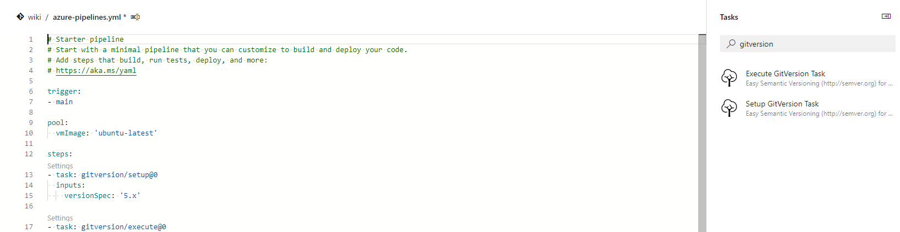
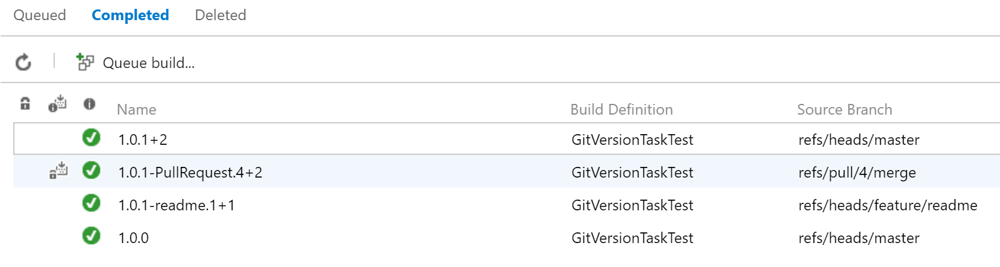

# GitTools bundle for Azure Pipelines

Versioning when using Git, solved. GitVersion looks at your Git history and works out the [semantic version](https://semver.org) of the commit being built.

It works with most branching strategies but has been designed mainly around GitFlow and GitHubFlow (pull request workflow). The calculated version numbers can then be accessed through variables such as `$(GitVersion_FullSemVer)` and `$(GitVersion_SemVer)`. It is also very configurable to allow it to work with most release workflows!

## Azure Pipelines tasks

## Azure Pipelines run examples

## GitVersion 7 and the v5 tasks

The upcoming v5 tasks require the .NET 10 SDK and GitVersion 7. Keep v4 tasks
for GitVersion 6. See the [migration guide](https://github.com/GitTools/actions/blob/main/docs/migration-v5.md)
for nested configuration, POSIX arguments and changed pre-release outputs.
